<picture>
  <source media="(prefers-color-scheme: dark)" srcset="assets/hero-dark.svg">
  
</picture>

**[LinkedIn](https://www.linkedin.com/in/alexisso/)** &nbsp;·&nbsp; **[nodobravo.mx](https://nodobravo.mx)** &nbsp;·&nbsp; **[NodoBravo en GitHub](https://github.com/NODOBRAVO)** &nbsp;·&nbsp; Jalisco, México

 

<picture>
  <source media="(prefers-color-scheme: dark)" srcset="assets/stats-dark.svg">
  
</picture>

## Qué hago

Soy líder de tecnología especializado en FinOps, infraestructura y arquitectura multicloud. Ayudo a las organizaciones a **controlar su inversión en AWS, Google Cloud y Azure** mientras construyen plataformas escalables, resilientes y alineadas con los objetivos del negocio.

| Lo que resuelvo | Cómo lo hago |
|---|---|
| **Controlo el gasto cloud** | Estrategias FinOps, gobierno financiero y optimización de recursos: reducciones de costo de hasta 45%. |
| **Diseño arquitectura y gobierno multicloud** | Modelos que equilibran costo, rendimiento, seguridad y escalabilidad. |
| **Automatizo la infraestructura** | DevOps y Platform Engineering con Terraform, CloudFormation, Kubernetes y CI/CD: menos errores manuales y despliegues hasta 40% más rápidos. |
| **Llevo IA generativa a la operación** | Soluciones con Amazon Bedrock y AWS SageMaker para optimizar procesos operativos y de negocio, incluidos sistemas RAG sobre documentación técnica. |
| **Formo y acompaño equipos técnicos** | Liderazgo de equipos con cultura de colaboración, responsabilidad y mejora continua. |

## NodoBravo

Soy **Founder & Community Lead de [NodoBravo](https://nodobravo.mx)**, una iniciativa que conecta talento tecnológico con formación, comunidad y oportunidades profesionales, y consultora de FinOps y cloud en LATAM.

| Servicios profesionales | Formación |
|---|---|
| **Migración cloud** | **Cloud Launchpad** |
| **FinOps gestionado**: auditoría de costos, gobierno del gasto, Savings Plans y Reserved Instances | **FinOps en Acción** |
| **Automatización con IA** | **IA Sin Límites** |

## Lo que comparto

Escribo en [LinkedIn](https://www.linkedin.com/in/alexisso/) sobre cloud, FinOps, automatización e inteligencia artificial aplicada a empresas. Entre lo que más comparto: rutas de certificación y aprendizaje gratuito (AWS, Anthropic, Google Cloud, Oracle) y lo que aprendo en eventos como el Google Cloud Summit México.

## Proyectos destacados

| Proyecto | Qué hace |
|---|---|
| [**Nimbus Explorer**](https://github.com/NODOBRAVO/nimbus-explorer) | Convierte facturas de AWS, Azure, Google Cloud y FOCUS en decisiones FinOps auditables. El motor calcula; Atlas, sobre Amazon Bedrock, explica y prioriza sin inventar cifras. Construido con Kiro para el Hackathon AWS de Código Facilito. |
| [**Atlas ciudadano**](https://github.com/NODOBRAVO/atlas-ciudadano) | Sitio interactivo para explorar la participación ciudadana en las elecciones federales de México de 2009 a 2024, por estado, municipio, sexo y edad. Hecho por el equipo Pixel Ciudadano para el hackathon del INE 2026. |

## Stack

<picture>
  <source media="(prefers-color-scheme: dark)" srcset="assets/stack-dark.svg">
  
</picture>

## Hablemos

¿Tu organización busca **optimizar su operación cloud, fortalecer sus equipos o convertir la infraestructura en una ventaja para el negocio**? Conversemos por [LinkedIn](https://www.linkedin.com/in/alexisso/) o desde [nodobravo.mx](https://nodobravo.mx).

Logos: [simple-icons](https://simpleicons.org) (CC0). Las marcas pertenecen a sus respectivos dueños.
